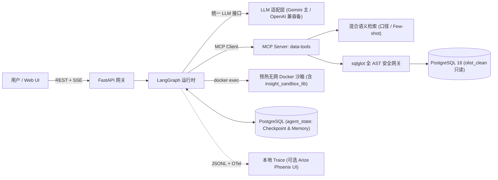
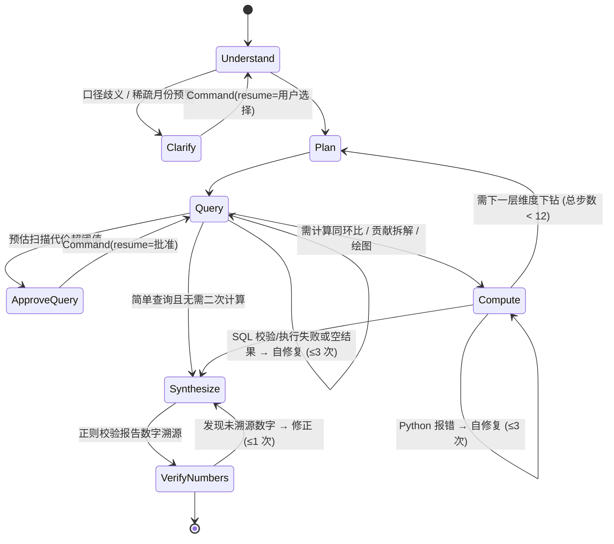

# 02 · 技术设计文档（TDD）

> 版本：v0.2（根据 `S0_review.md` 全面修订，补齐沙箱加固、SQL 多层防御、检索策略、会话记忆、节点 Schema、可观测降级与配额预算）。

## 1. 总体架构



## 2. 技术选型与版本约束

| 层级 | 选型 | 理由与关键决策索引 |
| :-- | :-- | :-- |
| 语言与工程管理 | Python 3.13 + `venv` + `pyproject.toml` + `ruff` + `pytest` | 本机已装 3.13.15；统一 lint 与单测门禁 |
| LLM 与适配层 | 主：`google-genai`（`gemini-3.8-flash` / `gemini-3.5-flash-lite`）<br>备：`openai` SDK（兼容 DeepSeek / Qwen） | 支持 `HTTPS_PROXY`；解决中国大陆地区限制与限流降级风险（`ADR-001`） |
| Embedding | 主：`gemini-embedding-2`（768 维截断/原生维度配置）<br>备：本地轻量或兼容 API | 仅用于口径字典、Few-shot SQL 与干扰表实验（`ADR-004`） |
| 编排与状态持久化 | LangGraph + `langgraph-checkpoint-postgres` | 原生支持 `interrupt`/`Command(resume=...)` 与断点恢复（`ADR-003`, `ADR-005`） |
| 工具协议 | MCP Python SDK（`stdio` 本地进程 / `streamable-http`） | 工具契约标准化，便于独立单测与外部客户端复用 |
| 数据库 | PostgreSQL 16 + `pgvector`（Docker 镜像 `pgvector/pgvector:pg16`） | 同时承载业务只读库（`olist_raw` / `olist_clean`）与状态库（`agent_state`） |
| SQL 解析与重写 | `sqlglot`（`postgres` 方言） | 完整遍历 AST 阻断可写 CTE、危险函数与多语句，精准处理 `LIMIT` |
| 代码执行沙箱 | 预热加固 Docker 容器（预装 `pandas/numpy/scipy/matplotlib` + `insight_sandbox_lib`） | 消除冷启动开销，确定性归因函数避免模型手写数学 Bug（`ADR-005`） |
| API 与流式协议 | FastAPI + `sse-starlette` | 标准 REST + SSE 流式事件 + HITL 恢复端点 |
| 可观测性 | 本地结构化 JSONL + OpenTelemetry（可选单容器 Arize Phoenix） | 替代需 6 容器/16GB 内存的 Langfuse v3 自托管方案（`ADR-006`） |

## 3. 工程目录结构

```text
insight-agent/
├── docs/                        # 全生命周期文档、ADR、评审与阶段报告
├── prompts/                     # 版本化 Prompt 模板（YAML/Jinja2，记录版本号）
├── infra/
│   ├── docker-compose.yml       # Postgres (绑定 127.0.0.1) + 沙箱 worker + 可选 Phoenix
│   ├── db/                      # 01_schemas.sql, 02_clean_views.sql, 03_readonly_role.sql
│   └── sandbox/                 # Dockerfile.sandbox（含只读非 root 配置与预置分析库）
├── data/                        # 原始 zip 与解压 CSV（.gitignore 忽略）
├── runs/                        # 运行时会话产物 runs/<thread_id>/<run_id>/（定期清理）
├── traces/                      # 本地 JSONL 调用链日志 traces/YYYY-MM-DD/<trace_id>.jsonl
├── scripts/
│   ├── smoke_test_llm.py        # S1 入口：验证代理、地区可用性与模型列表
│   ├── ingest_olist.py          # 导入 Olist、校验行数与 SHA256
│   ├── validate_glossary.py     # 自动执行口径字典中全部 sql_template
│   └── run_eval.py              # S4 断点续跑评测脚本
├── src/insight_agent/
│   ├── config.py                # Pydantic Settings（含代理、模型、超时、预算配置）
│   ├── llm/                     # LLMProvider 协议：GeminiProvider / OpenAICompatProvider / 重试限流
│   ├── semantic/                # 核心 Schema 摘要生成 + 口径/Few-shot 混合检索（BM25 + 向量）
│   ├── security/                # sql_guard.py (sqlglot 全树校验)、prompt_guard.py
│   ├── mcp_server/              # data-tools MCP Server 实现
│   ├── analysis_lib/            # 打包进宿主机与沙箱镜像的确定性贡献拆解算法库
│   ├── sandbox/                 # Docker 预热沙箱管理与受限执行器
│   ├── memory/                  # 用户确认口径记忆 CRUD（Postgres agent_state.user_memory）
│   ├── observability/           # JSONL Trace 记录器 + OpenTelemetry 导出器
│   ├── agent/                   # state.py, schemas.py, nodes/, graph.py
│   └── api/                     # FastAPI app, routes, sse_events.py
├── eval/
│   ├── golden_set/              # 人工验证题目与标准 SQL/答案（CC BY-NC-SA 4.0 声明）
│   └── evaluators/              # SQL 断言、数值容差匹配、数字溯源幻觉检测器、LLM Judge
└── tests/                       # unit/, security/, integration/
```

## 4. 数据库 Schema 与数据治理设计（解决 Olist 脏数据）

单实例 PostgreSQL 划分为 4 个逻辑 Schema，职责与权限严格物理隔离：

1. **`olist_raw`**：原样导入 Kaggle 9 张 CSV（保留 `product_name_lenght` 等原始拼写，便于核对官方行数）。
2. **`olist_clean`（Agent 默认查询的唯一业务 Schema）**：通过初始化 SQL 构建清洗表/物化视图：
   - **评价去重**：`reviews` 按 `order_id` 取最新一条有效记录（解决原始表 ~800 条 `review_id` 重复与一单多评导致 JOIN 膨胀问题），同时保留 `order_reviews_all` 供明细核查。
   - **品类标准化与空值兜底**：预先关联英文翻译表，生成 `category_en = COALESCE(t.product_category_name_english, p.product_category_name, 'uncategorized')`，并修正列名拼写为 `product_name_length` / `product_description_length`。
   - **邮编去重视图**：`geolocation_zip_prefix` 按 `geolocation_zip_code_prefix` 聚合经纬度均值与州/城市众数，防止直接 JOIN 造成笛卡尔积爆炸。
   - **时间标准化**：所有时间列转为 `TIMESTAMP WITHOUT TIME ZONE`（声明为巴西本地业务时间），建立 `order_purchase_timestamp`、`customer_state`、`order_status` 索引。
3. **`olist_distractor`（可选压测 Schema，S4 启用）**：自动生成 30 张模拟企业 ERP/HR/日志干扰表，用于客观评测 Schema 检索在多表环境下的真实收益（`ADR-004`）。
4. **`agent_state`（仅后端服务账号可读写，`readonly_analyst` 无权限）**：存储 LangGraph Checkpoints、口径向量索引与用户确认记忆。

## 5. 语义层与上下文策略（`ADR-004`）

针对评审指出的“Olist 仅 9 张表无需强行向量召回 Schema”问题，采取实事求是的分层设计：
- **常规模式（9 张清洗表）**：`olist_clean` 精简 Schema 摘要仅约 1,800 tokens，**常驻注入上下文**（100% 召回不丢表）；混合检索（PostgreSQL `tsvector` 关键词 + `pgvector` 语义检索）专门用于召回：
  1. 匹配的**业务指标定义、SQL 模板与维度兼容约束**（来自 `03_metrics_glossary.yaml`）；
  2. 最相似的 **Top-3 历史验证 Few-shot SQL**；
  3. 当前用户已确认的**口径偏好记忆**。
- **扩展压测模式（9 + 30 张干扰表）**：关闭全量 Schema 常驻，启用表级混合召回（Top-8 表），在 S4 中定量评测表召回准确率（Recall@8）。

## 6. Agent 状态机与节点结构化契约（Pydantic I/O）

### 6.1 状态流转图



### 6.2 节点结构化输出 Schema（核心契约）

| 节点 | 输入依赖 | LLM 结构化输出 Schema（Pydantic） |
| :-- | :-- | :-- |
| `Understand` | `question`, 口径检索结果, 用户记忆 | `IntentOutput`: `{task_type: Literal["query","trend","decomposition","correlation","cohort"], resolved_metrics: list[str], time_range: tuple[str,str]\|None, ambiguity: AmbiguityPrompt\|None, sparse_data_warning: bool}` |
| `Plan` | `IntentOutput`, Schema 摘要 | `PlanOutput`: `{steps: list[PlanStep], decomposition_method: Literal["none","additive","lmdi","pvm"]}` |
| `Query` | 当前 `PlanStep`, 历史报错 | `SQLGenerationOutput`: `{thought: str, sql: str, expected_grain: str}` |
| `Compute` | 已落盘 CSV 路径与列信息, 拆解方法 | `SandboxCodeOutput`: `{thought: str, python_code: str, expected_artifacts: list[str]}` |
| `Synthesize` | 各步执行结果与沙箱 `stdout` JSON | `ReportOutput`: `{summary_markdown: str, cited_numbers: list[NumberCitation], include_causality_disclaimer: bool}` |

**熔断与预算守卫**：单节点修复重试 `≤ 3` 次；全局节点跳转 `≤ 12` 步；单次运行累计 Token `≤ 60,000`，任一超限立即转入 `Synthesize` 输出已有确定性证据与中止原因。

## 7. MCP 工具契约与多层 SQL 安全网关

### 7.1 MCP 工具定义（`data-tools`）
| 工具名 | 入参 Schema | 出参 Schema |
| :-- | :-- | :-- |
| `retrieve_context` | `question: str, include_distractors: bool = False, top_k: int = 5` | `{schema_ddl: str, matched_metrics: list[dict], incompatible_pairs: list[dict], few_shots: list[dict]}` |
| `execute_readonly_sql` | `sql: str, run_id: str, step_id: str, max_rows: int = 500` | `{ok: bool, columns: list[str], preview_rows: list[list], row_count_returned: int, truncated: bool, csv_workspace_path: str, execution_ms: int, error: ErrorDetail\|None}` |
| `explain_sql` | `sql: str` | `{ok: bool, estimated_rows: int, estimated_cost: float, plan_summary: str}` |

### 7.2 四层 SQL 安全防护（解决可写 CTE 与静默截断）
1. **语法树白名单（`sqlglot`）**：
   - 仅允许单条语句，根节点必须为 `exp.Select` 或 `exp.Union`；
   - **全树深度遍历**：只要子树中出现任何 `Insert / Update / Delete / Drop / Alter / Create / Command / Into / Locking (FOR UPDATE)` 节点（包括 `WITH del AS (DELETE ...)` 可写 CTE），立即拒绝；
   - **Schema 与函数黑名单**：禁止访问 `pg_catalog`、`information_schema`、`agent_state`；禁止调用 `pg_sleep`、`pg_read_file`、`pg_ls_dir`、`dblink`、`lo_import`、`lo_export`、`set_config` 等系统函数。
2. **智能截断检测（`LIMIT max_rows + 1`）**：
   - 若原查询无更小 `LIMIT`，外层包裹 `SELECT * FROM (<query>) AS _q LIMIT 501`；若返回 501 行，则截取前 500 行给预览并标记 `truncated: true`，同时将完整聚合或限流结果（上限 50,000 行供沙箱分析）写入 `runs/<thread_id>/<run_id>/<step_id>.csv`，防止模型把截断表当全量表求和。
3. **数据库角色硬隔离**：
   ```sql
   ALTER ROLE readonly_analyst SET default_transaction_read_only = on;
   ALTER ROLE readonly_analyst SET statement_timeout = '15s';
   ALTER ROLE readonly_analyst SET idle_in_transaction_session_timeout = '30s';
   ALTER ROLE readonly_analyst SET search_path = olist_clean;
   ```

## 8. 预热加固沙箱与确定性拆解库（`ADR-005`）

### 8.1 解决冷启动、只读冲突与挂载问题
- **运行模式**：`docker compose` 启动一个常驻受限容器 `insight-sandbox-worker`（主进程 `sleep infinity`），每次执行通过 `docker exec --workdir /workspace/<thread_id>/<run_id>` 调用，单步开销从 ~2.5s 降至 `< 150ms`，单次 `exec` 超时强制 `kill`（30s）。
- **容器加固参数**：
  - `network_mode: "none"`（彻底断网）
  - `read_only: true` + `tmpfs: ["/tmp:rw,noexec,nosuid,size=64m"]`
  - 环境变量 `MPLCONFIGDIR=/tmp/matplotlib`、`PYTHONDONTWRITEBYTECODE=1`（彻底解决 `matplotlib` 在只读根文件系统报错问题）
  - `user: "65534:65534"`（`nobody`）、`cap_drop: ["ALL"]`、`security_opt: ["no-new-privileges:true"]`、`pids_limit: 64`、`mem_limit: "512m"`、`cpus: 1.0`。
- **共享目录**：宿主机 `./runs` 绑定挂载到沙箱 `/workspace:rw`；MCP Server 导出的 `<step_id>.csv` 直接位于该目录，沙箱输出的 PNG 图表与 `result.json` 写回同一目录，由 FastAPI 静态安全端点校验路径后对外提供。

### 8.2 预置确定性分析库 `insight_sandbox_lib`
将统计拆解函数预装进沙箱镜像（并配齐 `pytest` 单元测试），Agent 只需加载 CSV 并调用标准函数，避免现场手写公式出错：
1. `additive_contributions(df, dim_col, base_col, curr_col)`：计算各维度绝对变化量、增长率、对总体变化的拉动点数与贡献占比（`ΔY_i / ΔY`）。
2. `lmdi_two_factor(base_orders, curr_orders, base_aov, curr_aov)`：对数平均迪氏指数法（LMDI）无残差拆分 `GMV = 订单数 × 客单价`；内置非正数检测（当某子项为 0 时自动退化为精确两因素均值差分分解）。
3. `pvm_mix_decomposition(df, dim_col, q_base, q_curr, p_base, p_curr)`：**价格-销量-结构（Price-Volume-Mix）三效应分解**，识别“各子品类客单价都没降，但低价品类占比上升拉低整体客单价”的辛普森悖论场景。
4. `detect_ts_anomalies(series, window=3, z_threshold=2.0)`：时序滚动同环比与异常点标记。

## 9. 会话、记忆与 API 契约

### 9.1 会话与口径记忆策略
- **会话状态**：使用 `thread_id`（UUID）标识会话，持久化于 `agent_state` Schema 中的 LangGraph Checkpoint 表。
- **长期口径记忆（`agent_state.user_memory`）**：
  - 字段：`user_id`, `metric_or_term`, `confirmed_rule`, `confirmed_at`, `source_thread_id`, `is_active`。
  - **写入规则**：仅当用户在 `Clarify` HITL 节点点击确认并勾选“记住此口径”时写入；绝不把模型的未确认猜测写入长期记忆。
  - **冲突与过期**：同一 `metric_or_term` 新确认自动将旧记录置为 `is_active = false`；提供 API 查看与一键清空。

### 9.2 REST 与 SSE 接口清单（S2 细化至 `05_api_contract.md`）
| 方法与路径 | 用途 |
| :-- | :-- |
| `POST /api/v1/chat/stream` | 发起提问，返回 `text/event-stream`（事件：`step`, `sql`, `sandbox`, `artifact`, `interrupt`, `report`, `error`） |
| `POST /api/v1/chat/{thread_id}/resume` | 提交 HITL 用户选择（如口径选项、批准执行），恢复图运行并继续流式返回 |
| `GET /api/v1/threads/{thread_id}` | 查询历史消息与状态快照 |
| `GET /api/v1/artifacts/{thread_id}/{run_id}/{filename}` | 安全读取图表/导出结果（严格校验文件名防路径穿越 `..`） |
| `GET /api/v1/memory` / `DELETE /api/v1/memory/{id}` | 查看与清理已记住的业务口径偏好 |
| `GET /api/v1/health` | 检查 DB 只读连接、沙箱容器状态与 LLM 配置状态 |

## 10. API 配额与调用量容量规划（Gemini 免费层 / 低成本预算）

| 阶段 / 场景 | 预估 LLM 请求数 | 预估总 Token 量 | 限流防护策略 |
| :-- | :-- | :-- | :-- |
| 日常单题交互（简单查询） | 2 ~ 3 次 / 题 | ~5K tokens | `gemini-3.5-flash-lite` 处理轻量节点 |
| 日常单题交互（多步拆解） | 5 ~ 8 次 / 题 | ~22K tokens | 常驻 Schema 利用隐式/显式 Prompt Caching |
| S4 全量评测（45 题 × 3 版本 + Judge） | ~750 次 | ~2.5M tokens | 评测器内置**逐题落盘断点续跑 + RPM 令牌桶限速（如 10 RPM）+ 指数退避**；若触发日配额上限（RPD），支持无缝切至按量计费（约 \$1~2）或 DeepSeek API 完成跑分 |

## 11. 风险登记册与应对预案

| 编号 | 风险描述 | 影响 | 对策 |
| :-- | :-- | :-- | :-- |
| R-1 | **Gemini API 中国大陆地区封锁（`FAILED_PRECONDITION: User location is not supported`）** | 阻塞全部 LLM 调用 | 1. `config.py` 原生读取 `HTTPS_PROXY`；<br>2. S1 第一步跑 `smoke_test_llm.py` 验证出口地区；<br>3. 内置 `OpenAICompatProvider` 随时可切 DeepSeek / Qwen |
| R-2 | Gemini 免费层 RPM/RPD 限流及平台数据改进隐私条款 | 评测中断 / 隐私风险 | 令牌桶限速 + 指数退避 + 断点续跑；严格只用公开 Olist 数据，禁入私密数据 |
| R-3 | Olist 脏数据（评价重复、品类缺失、列名拼写、邮编重复）导致算错 | 指标失真 | S1 建立 `olist_clean` 标准化层并在口径字典声明兼容矩阵 |
| R-4 | Windows 下 Docker Desktop 挂载 `D:` 盘权限或路径格式异常 | 沙箱读不到 CSV | 统一通过容器内固定路径 `/workspace/...` 传递相对路径，宿主机不向沙箱传盘符路径；S2 优先联调 |
| R-5 | Olist 无流量/促销数据导致模型“强行编造因果原因” | 面试与专业度失分 | Prompt 强约束 + 报告模板自动附加“贡献拆解 ≠ 因果推断”边界声明 |
