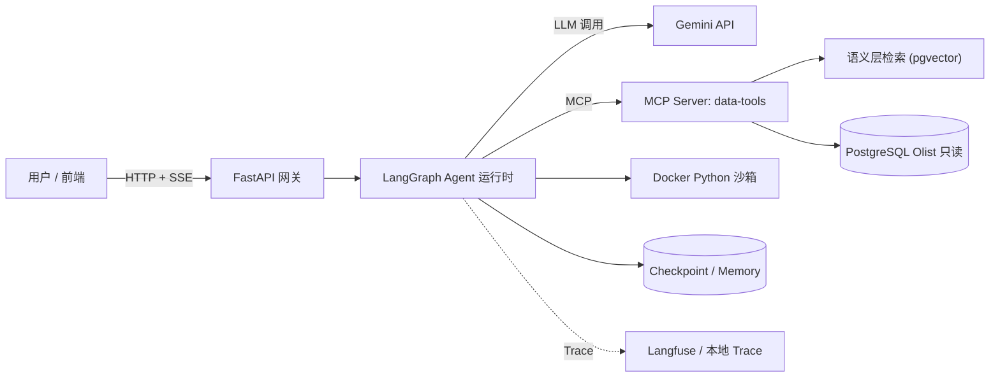
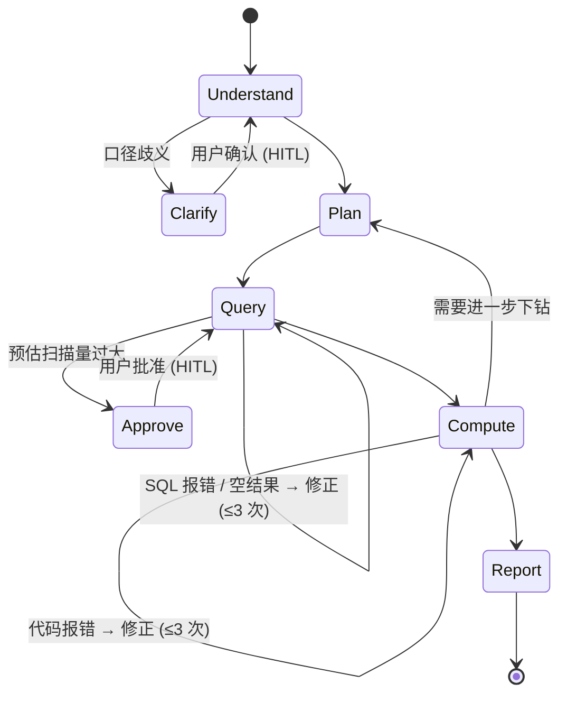

# 02 · 技术设计文档（TDD）

> 版本 v0.1（S0 评审稿）。实现中若有偏差，以 ADR 记录并回填本文。

## 1. 总体架构



## 2. 技术选型

| 层 | 选型 | 理由 |
| :-- | :-- | :-- |
| 语言 / 运行时 | Python 3.13（venv + pip） | 本机已具备 |
| LLM | Gemini API（Google AI Studio Key），模型名可配置 | 见 ADR-001 |
| 编排 | LangGraph | 有状态图、Checkpoint、原生中断（HITL），见 ADR-003 |
| 工具协议 | MCP（官方 Python SDK） | 工具与模型解耦 |
| 数据库 | PostgreSQL 16 + pgvector（Docker） | 数仓模拟 + 向量检索一体 |
| SQL 校验 | sqlglot | AST 级校验与改写（加 LIMIT） |
| 沙箱 | Docker 容器（`--network none`、CPU/内存/超时限制） | 隔离执行模型代码 |
| API | FastAPI + SSE | 流式输出 |
| 观测 | Langfuse（可选自托管）/ 本地 JSONL Trace | 调用链与成本 |
| 测试 | pytest | 单元 + 集成 |

## 3. 目录结构（S2 落地）

```text
insight-agent/
├── docs/                 # 全生命周期文档
├── infra/                # docker-compose、数据库初始化 SQL、沙箱镜像
├── data/                 # 原始数据（git 忽略）
├── scripts/              # 数据导入、索引构建、评测运行
├── src/insight_agent/
│   ├── config.py
│   ├── llm/              # Gemini 客户端封装、重试、降级
│   ├── semantic/         # 元数据 / 口径 / Few-shot 检索
│   ├── mcp_server/       # data-tools MCP Server
│   ├── sandbox/          # Docker 沙箱执行器
│   ├── analysis/         # 归因算法（贡献度、因素分解、异常检测）
│   ├── agent/            # LangGraph 状态、节点、图
│   └── api/              # FastAPI 路由与 SSE
├── eval/                 # Golden Set、评测器、报告生成
└── tests/
```

## 4. Agent 状态机设计



**State 字段（草案）**：`question`、`resolved_metrics`、`plan[]`、`steps[]`（每步 SQL / 代码 / 结果摘要 / 产物路径）、`artifacts[]`（图表、CSV）、`retry_count`、`total_steps`、`pending_interrupt`、`final_report`。

**熔断**：单节点重试 ≤ 3；全局步数 ≤ 15；单题 Token 预算可配置，超出即输出“部分结论 + 失败原因”。

## 5. MCP 工具契约（v0.1）

| 工具 | 入参 | 出参 |
| :-- | :-- | :-- |
| `retrieve_context` | `question: str, top_k: int=5` | 相关表结构、指标口径、Few-shot SQL |
| `execute_readonly_sql` | `sql: str, max_rows: int=1000` | `columns, rows(截断), row_count, result_file`（完整结果落盘供沙箱读取） |
| `explain_sql` | `sql: str` | 预估代价，用于 HITL 判断 |

错误统一格式：`{"error": {"type": "...", "message": "...", "hint": "..."}}`，`hint` 供模型自修复。

## 6. 沙箱设计
- 镜像：`python:3.13-slim` + pandas / numpy / scipy / matplotlib。
- 运行：`--network none --memory 512m --cpus 1 --read-only`，挂载本次任务的 `workdir`（输入 CSV、输出图表）；超时 30s。
- 返回：stdout、stderr、产物文件列表；结果数字必须由代码 `print` 输出，作为报告溯源依据。

## 7. 归因方法（S3）
- **维度贡献度**：ΔY = Σ ΔYᵢ，按州 / 品类 / 支付方式等维度计算各子项对总变化的贡献占比。
- **乘法因素分解**：GMV = 订单数 × 客单价，用对数分解（LMDI）拆分两因素贡献。
- **异常检测**：时间序列 z-score / 同环比阈值定位异常时段与维度。

## 8. SSE 事件协议（草案，S2 定稿到 `05_api_contract.md`）

| event | data |
| :-- | :-- |
| `step` | 节点名、状态、说明 |
| `sql` | SQL 文本、行数 |
| `artifact` | 图表 / 文件 URL |
| `interrupt` | 需要用户确认的问题与选项 |
| `report` | 最终 Markdown 报告 |
| `error` | 错误信息 |

## 9. 安全设计
- DB：`readonly_analyst` 账号，仅 `SELECT` 权限；`statement_timeout = 15s`。
- SQL：sqlglot 解析，拒绝非 SELECT、多语句、系统表访问；自动注入 `LIMIT`。
- Prompt：系统指令与用户输入分隔；工具层校验不依赖模型自觉。
- 密钥：`.env` + `.gitignore`；日志脱敏。

## 10. 风险与对策

| 风险 | 对策 |
| :-- | :-- |
| Gemini API 免费额度限流 | 指数退避重试；评测并发可调；缓存 |
| Olist 下载需 Kaggle 登录 | 支持手动下载 zip 放入 `data/raw/` |
| 葡萄牙语字段 / 品类名 | 使用官方英文翻译表，并在口径字典中提供中文别名 |
| 本机 Docker 未运行 | S1 前确认 Docker Desktop 已启动 |
